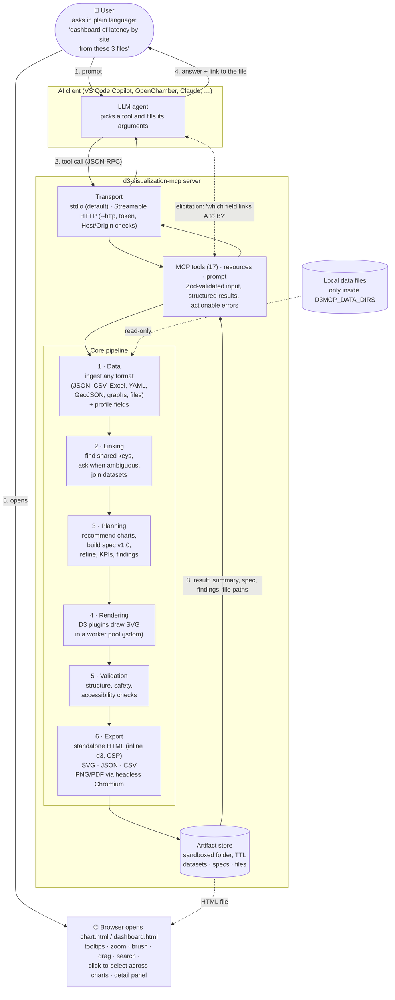

# Universal D3 Visualization MCP Server

`d3-visualization-mcp` is a TypeScript [Model Context Protocol](https://modelcontextprotocol.io/) server. It lets AI agents analyze data, plan visualizations from natural-language requests, and render, validate, refine, compose and export them with [D3.js](https://d3js.org/) v7.9.0. The output is standalone interactive HTML, SVG, PNG, PDF, JSON specs and CSV.

The verification status at the bottom of this file comes from real runs of `npm run verify` (see `reports/verification-report.md`).

## Contents

- [Architecture](#architecture)
- [Feature matrix](#feature-matrix)
- [Install and run](#install-and-run)
- [MCP tools](#mcp-tools)
- [Data formats](#data-formats)
- [Example prompts](#example-prompts)
- [Automatic dashboards](#automatic-dashboards)
- [Linking multiple data sources](#linking-multiple-data-sources)
- [Network topologies with icons](#network-topologies-with-icons)
- [Artifacts and export](#artifacts-and-export)
- [Client setup: OpenChamber, VS Code](#client-setup)
- [D3 API coverage](#d3-api-coverage)
- [Security and privacy](#security-and-privacy)
- [Testing and verification](#testing-and-verification)
- [Performance](#performance)
- [Limitations and roadmap](#limitations-and-roadmap)

## Architecture



**How a request flows**

1. You ask the AI assistant for a chart or dashboard and name your data: pasted rows, a file path, a spreadsheet, a network or a map.
2. The assistant calls one of the server's tools, such as `d3_visualize`, `d3_create_dashboard` or `d3_link_datasets`. The server checks the arguments against a schema.
3. The core pipeline runs:
   - **Data:** the input is parsed into a dataset and each field is profiled (numbers, dates, categories, outliers).
   - **Linking:** with several datasets, the server finds the keys they share and joins them. If a link is ambiguous, it asks you through the assistant.
   - **Planning:** a deterministic planner chooses the chart types and builds a reusable JSON spec.
   - **Rendering:** D3 renders the spec to SVG in a background worker.
   - **Validation:** the output is checked for structure, safety and accessibility.
   - **Export:** the result is written as HTML/SVG/PNG/PDF/CSV.
4. The assistant gets back a summary, the spec, findings and absolute file paths, and replies to you.
5. You open the HTML file in a browser. It works offline and is fully interactive. You can ask the assistant to refine or export it further.

D3 renders the SVG server-side into a jsdom document, so every artifact is checked structurally before it is written. The standalone HTML embeds that SVG plus d3 and a small runtime that adds tooltips, zoom, brush, drag, search, keyboard navigation, linked highlighting and canvas point clouds. Protocol, planning, rendering, validation and export are separate layers. New chart types are added by registering a `RendererPlugin`; the MCP layer doesn't change. See [docs/architecture.md](docs/architecture.md).

## Feature matrix

| Capability                                                                                                                                   | Status                                    | Evidence                                                                                                               |
| -------------------------------------------------------------------------------------------------------------------------------------------- | ----------------------------------------- | ---------------------------------------------------------------------------------------------------------------------- |
| stdio MCP transport (official SDK 1.32.2)                                                                                                    | ✅ verified                               | `tests/integration/mcp.test.ts`, `npm run smoke`                                                                       |
| Streamable HTTP transport (`--http`)                                                                                                         | ✅ verified                               | `tests/integration/http.test.ts`: SDK HTTP client, sessions, bearer auth, Host/Origin checks                           |
| 17 MCP tools, 2 resources, 1 prompt                                                                                                          | ✅ verified                               | integration tests                                                                                                      |
| 32 visualization types (below)                                                                                                               | ✅ unit-tested; 9 types browser-tested    | `tests/unit/renderers.test.ts`, `tests/browser/`                                                                       |
| Natural-language planning + refinement                                                                                                       | ✅ deterministic, keyword/heuristic based | `tests/unit/planning.test.ts`                                                                                          |
| Data input: JSON, JSON Lines, YAML, CSV/TSV/any delimiter, Excel (xlsx/xlsm/xlsb/xls), ODS, GeoJSON, TopoJSON, as text, base64 or local file | ✅ verified                               | `tests/unit/formats.test.ts` (25), integration scenarios 12–15 (including an 8-format dashboard)                       |
| Automatic dashboards (`d3_create_dashboard`): chart selection, KPI tiles, per-sheet / multi-dataset                                          | ✅ verified                               | `tests/unit/dashboard.test.ts` (16), integration scenarios 16–19                                                       |
| Multi-source linking: key inference across formats, questions via MCP elicitation, joins, cross-chart entity selection, detail panel         | ✅ verified                               | `tests/unit/link.test.ts` (15), integration scenarios 20–26 (incl. a real elicitation round trip), Chromium click test |
| Dashboards with shared filter, linked highlight, time brush                                                                                  | ✅ verified in Chromium                   | `tests/browser/artifacts.spec.ts`                                                                                      |
| Topology icons (18 built-in + custom path/SVG icons), tiered layout                                                                          | ✅ verified                               | `tests/unit/icons.test.ts`, integration scenario 11, browser drag/search test, 2 pixel baselines                       |
| HTML / SVG / JSON / CSV export                                                                                                               | ✅ always available                       | unit + integration tests                                                                                               |
| PNG / PDF export                                                                                                                             | ✅ when Chromium is installed             | browser tests, smoke test                                                                                              |
| Canvas rendering for large scatterplots                                                                                                      | ✅ verified (50k points)                  | browser test, benchmark                                                                                                |
| Safe declarative D3 composition (`d3_execute_composition`)                                                                                   | ✅ whitelisted ops only, no eval          | unit + security tests                                                                                                  |
| React + Vite workbench                                                                                                                       | ✅ builds, browser-tested                 | `workbench/`, `tests/browser/workbench.spec.ts`                                                                        |
| Off-main-thread rendering (`worker_threads` pool, timeouts)                                                                                  | ✅ verified                               | `tests/unit/pool.test.ts`: event loop stays responsive during a 2k-node force layout                                   |
| Pixel-comparison visual regression (14 baselines)                                                                                            | ✅ verified on macOS                      | `tests/browser/visual.spec.ts`                                                                                         |
| Remote data fetching (d3-fetch)                                                                                                              | 🚫 disabled by design                     | security policy                                                                                                        |

**Visualization types:** bar (vertical/horizontal), grouped-bar, stacked-bar, waterfall, line, area, stacked-area, cumulative, scatter, bubble, connected-scatter, histogram, boxplot, density, heatmap, pie, donut, treemap, partition (icicle), sunburst, pack, tree (incl. radial), cluster (dendrogram), force, radial-network, chord, **sankey** (plugin, `d3-sankey` — not core D3), geo (choropleth, GeoJSON, lat/lon points; 12 projections), voronoi, delaunay, contour, custom (declarative shapes). Small multiples and coordinated views are built with `d3_compose_visualizations`.

## Install and run

Prerequisites: Node.js ≥ 20.19 (verified on v26.12.1, macOS arm64). PNG/PDF export and browser validation also need Playwright's Chromium.

```bash
npm ci
npx playwright install chromium   # optional but recommended
npm run build
npm start                         # stdio server; logs go to stderr
npm run start:http                # Streamable HTTP on http://127.0.0.1:3333/mcp
```

### HTTP transport

`node dist/server/index.js --http` (or `D3MCP_TRANSPORT=http`) serves MCP Streamable HTTP at `/mcp`, plus `GET /healthz`. Each client session gets its own MCP server instance; all sessions share the render worker pool.

| Variable                     | Default     | Meaning                                                                                                     |
| ---------------------------- | ----------- | ----------------------------------------------------------------------------------------------------------- |
| `D3MCP_HTTP_HOST`            | `127.0.0.1` | Bind address. A non-loopback address is refused unless a token is set.                                      |
| `D3MCP_HTTP_PORT`            | `3333`      | `0` picks a free port. The actual URL is logged to stderr.                                                  |
| `D3MCP_HTTP_TOKEN`           | unset       | When set, every request needs `Authorization: Bearer <token>` (constant-time compare).                      |
| `D3MCP_HTTP_ALLOWED_ORIGINS` | none        | Extra comma-separated browser origins. `Host` and `Origin` are always validated (DNS-rebinding protection). |

The server has no TLS of its own. To expose it beyond localhost, put it behind a TLS-terminating reverse proxy and set a token.

| Command                               | Purpose                                                      |
| ------------------------------------- | ------------------------------------------------------------ |
| `npm run dev`                         | Run from source with tsx                                     |
| `npm run verify`                      | Everything below + report (`reports/verification-report.md`) |
| `npm run smoke`                       | Real MCP round trip: server → client → bar chart → Chromium  |
| `npm test`                            | Unit, integration, browser tests                             |
| `npm run examples`                    | Regenerate `examples/`                                       |
| `npm run benchmark`                   | Timing for representative dataset sizes                      |
| `npm run audit:d3` / `audit:d3:check` | Rebuild D3 inventory / detect drift vs live official index   |
| `npm run workbench:dev`               | Local React workbench at http://127.0.0.1:5179               |

Configuration is by environment variables (see `.env.example`; the server does not read `.env` itself): `D3MCP_ARTIFACT_DIR`, `D3MCP_MAX_ROWS`, `D3MCP_MAX_INPUT_BYTES`, `D3MCP_ARTIFACT_TTL_HOURS`, `D3MCP_BROWSER_TIMEOUT_MS`, `D3MCP_LOG_LEVEL`, `D3MCP_RENDER_WORKERS` (default: CPUs − 1, max 4; `0` renders inline), `D3MCP_RENDER_TIMEOUT_MS` (default 60000; runaway renders are stopped), and the HTTP variables above.

## MCP tools

All tools validate input with Zod, return a text summary plus `structuredContent` (`{ ok: true, ... }`), and report failures as `isError: true` with `{ ok: false, error: { code, message, hint } }`.

| Tool                          | Purpose                                                                                                                                                                                                                                                          |
| ----------------------------- | ---------------------------------------------------------------------------------------------------------------------------------------------------------------------------------------------------------------------------------------------------------------- |
| `d3_visualize`                | Data + prompt → planned, rendered, validated artifact (spec, mapping, findings, file paths)                                                                                                                                                                      |
| `d3_recommend_visualizations` | Ranked chart options with the question each answers, rationale and trade-offs                                                                                                                                                                                    |
| `d3_analyze_data`             | Schema, types, missing/unique counts, numeric summaries, Tukey outliers, time span, correlations (descriptive only)                                                                                                                                              |
| `d3_create_spec`              | Validated reusable spec (dry-run rendered) without writing artifacts                                                                                                                                                                                             |
| `d3_render`                   | Render a spec to artifacts                                                                                                                                                                                                                                       |
| `d3_compose_visualizations`   | Dashboard with shared category filter, linked highlight, shared time brush                                                                                                                                                                                       |
| `d3_create_dashboard`         | **Automatic dashboard** from data + a goal: picks complementary charts, adds KPI tiles, links interactions; with several datasets it links them and cross-filters (see [Automatic dashboards](#automatic-dashboards), [Linking](#linking-multiple-data-sources)) |
| `d3_link_datasets`            | Find the shared keys between 2–8 datasets in any formats; asks the user (MCP elicitation) or returns questions when a link is ambiguous                                                                                                                          |
| `d3_join_datasets`            | Join two datasets on a key (case-insensitive) into a new `dataset_id`; enriches tables, graph nodes or map features; reports matched/unmatched                                                                                                                   |
| `d3_refine_visualization`     | Natural-language edits that preserve unrelated settings; new artifact linked to parent                                                                                                                                                                           |
| `d3_query_api`                | Search the D3 capability registry (status, docs URL, runtime arity)                                                                                                                                                                                              |
| `d3_execute_composition`      | Declarative pipeline of 55 whitelisted D3 operations; no code evaluation                                                                                                                                                                                         |
| `d3_validate_visualization`   | Structural/safety/accessibility checks; optional Chromium desktop+mobile checks                                                                                                                                                                                  |
| `d3_export`                   | Add PNG/PDF/CSV/... to an artifact; reports exact paths and per-format failures                                                                                                                                                                                  |
| `d3_get_artifact`             | Metadata, size-limited content, or list artifacts                                                                                                                                                                                                                |
| `d3_list_capabilities`        | Types, coverage counts, composition ops, export/browser availability, limits                                                                                                                                                                                     |
| `d3_get_test_report`          | Latest `npm run verify` report                                                                                                                                                                                                                                   |

Resources: `d3://schema/visualization-spec` (JSON Schema, also in `schemas/`) and `d3://capabilities/coverage`. Prompt: `visualize-data`.

## Data formats

Every tool that takes `data` (`d3_visualize`, `d3_analyze_data`, `d3_recommend_visualizations`, `d3_create_spec`, `d3_render`, `d3_execute_composition`, and each chart in `d3_compose_visualizations`) accepts all of the following.

| Format                   | Inline text `{format, text}` | Inline bytes `{base64}` |              Local file `{file}`              | Notes                                                                                                                              |
| ------------------------ | :--------------------------: | :---------------------: | :-------------------------------------------: | ---------------------------------------------------------------------------------------------------------------------------------- |
| JSON records / documents |            `json`            |            ✓            |                    `.json`                    | Arrays of objects; `{data:[…]}`-style wrappers, `records_path`, column-oriented and key/value objects are converted (and reported) |
| JSON Lines               |      `jsonl`, `ndjson`       |            ✓            |              `.jsonl` `.ndjson`               | One object per line; errors name the line                                                                                          |
| YAML 1.2                 |        `yaml`, `yml`         |            ✓            |                `.yaml` `.yml`                 | Tables, graphs and hierarchies; safe core schema (no code tags, alias-bomb limit, duplicate keys rejected)                         |
| CSV                      |            `csv`             |            ✓            |                    `.csv`                     | Delimiter auto-detected (`, ; tab \|`); decimal commas parsed in `;`/tab/`\|` files                                                |
| TSV / other delimiters   | `tsv`, `dsv` (+`delimiter`)  |            ✓            |          `.tsv` `.tab` `.psv` `.txt`          |                                                                                                                                    |
| Excel / spreadsheets     |          — (binary)          |            ✓            | `.xlsx` `.xlsm` `.xlsb` `.xls` `.ods` `.fods` | `sheet` (name, 1-based index, or `"all"`), `header_row`; formulas use cached values; dates → ISO text                              |
| GeoJSON                  |          `geojson`           |            ✓            |                  `.geojson`                   | Or pass the FeatureCollection object directly                                                                                      |
| TopoJSON                 |    `topojson` (+`object`)    |            ✓            |                  `.topojson`                  | Converted to GeoJSON; or pass the Topology object directly                                                                         |
| Graph                    |                              |                         |                                               | `{nodes:[…], links:[…]}` (also from JSON/YAML files)                                                                               |
| Hierarchy                |                              |                         |                                               | `{format:"hierarchy", root:{name, children}}` or any `{children:[…]}` document                                                     |

```jsonc
[{ "region": "EU", "sales": 10 }]                                          // records
{ "format": "csv", "text": "date;value\n2026-01-01;3,5" }                  // text (any text format)
{ "format": "yaml", "text": "- {site: SJC, latency: 21}\n- {site: NYC, latency: 48}" }
{ "format": "json", "text": "{\"response\":{\"items\":[…]}}", "records_path": "response.items" }
{ "base64": "UEsDBBQABgAIAAAAIQ…", "filename": "report.xlsx", "sheet": "Q3" }  // binary inline
{ "file": "~/Downloads/report.xlsx", "sheet": "all" }                      // local file
{ "file": "data/metrics.csv", "delimiter": ";" }                           // relative to the first data dir
{ "nodes": [{ "id": "a" }], "links": [{ "source": "a", "target": "b" }] } // graph
{ "format": "hierarchy", "root": { "name": "root", "children": [] } }     // hierarchy
{ "type": "FeatureCollection", "features": [] }                            // GeoJSON
{ "dataset_id": "ds_..." }                                                 // reuse stored data
```

### Reading local files

File input is **off by default**. Set `D3MCP_DATA_DIRS` to the directories the server may read; separate entries with `:` on macOS/Linux or `;` on Windows. Then pass `{"file": "<path>"}` as an absolute path, `~/…`, a `file://` URL, or a path relative to the first directory.

- The path is resolved with `realpath` **before** the check, so symlinks and `../` cannot leave the allowed directories.
- Only regular files up to `D3MCP_MAX_FILE_BYTES` (default 25 MB) are read.
- `http(s)://` URLs are rejected; nothing is ever downloaded.
- `d3_list_capabilities` → `data_input.file_access` shows the active directories.

Set `D3MCP_DATA_DIRS` in your client config to the folders you want to allow (for example `~/Downloads` and `~/Desktop`). The project-level `.vscode/mcp.json` allows only `examples/data-files`.

### Examples

Sample files in every format are in [`examples/data-files/`](examples/data-files/) (regenerate with `npx tsx scripts/generate-sample-files.ts`).

**Excel sheet → chart:**

```json
{
  "data": { "file": "~/Downloads/kpis.xlsx", "sheet": "KPIs" },
  "prompt": "Latency over time by site",
  "visualization_type": "line",
  "options": {
    "encoding": { "x": { "field": "date" }, "y": { "field": "latency_ms" }, "series": { "field": "site" } }
  }
}
```

The result's `dataset.origin` reports the file, the sheet used, and every sheet in the workbook.

**Dashboard from several files** (`d3_compose_visualizations`): each chart can read its own file and format. [`examples/dashboard-from-files/`](examples/dashboard-from-files/) shows eight charts from xlsx, ods, YAML, JSON Lines, a semicolon CSV with decimal commas, TopoJSON and a YAML graph. Its `request.json` is the exact tool call.

```json
{
  "title": "Q3 review",
  "charts": [
    {
      "data": { "file": "~/Downloads/q3.xlsx", "sheet": "Revenue" },
      "visualization_type": "bar",
      "prompt": "revenue by region"
    },
    {
      "data": { "file": "~/Downloads/q3.xlsx", "sheet": "KPIs" },
      "visualization_type": "line",
      "prompt": "latency over time by site"
    },
    { "data": { "file": "~/Desktop/inventory.yaml" }, "prompt": "devices by type" },
    { "data": { "file": "~/Downloads/events.jsonl" }, "prompt": "events per hour" }
  ]
}
```

**Natural-language prompts** that work once the folder is allowed:

- "Analyze `~/Downloads/sales.xlsx`, sheet _Q3_, and chart revenue by region."
- "Combine all sheets in `~/Desktop/budget.ods` and compare totals per sheet."
- "Build a dashboard from `~/Downloads/latency.csv` and `~/Downloads/topology.yaml`."

Ingestion documents every material transformation, such as delimiter detection, numeric and decimal-comma parsing, unwrapping, sheet selection, date conversion, truncation of over-long text and polygon rewinding. It never imputes, drops or normalizes values without saying so. Aggregation happens only when the spec asks for it, and it is reported in `transformations`.

Excel and ODS are read with [SheetJS CE 0.20.3](https://cdn.sheetjs.com/), vendored in `vendor/xlsx-0.20.3.tgz` (SHA-256 `8dc73fc3…99fe8`) from the official CDN. The npm `xlsx` package is frozen at 0.18.5, which has known vulnerabilities. Macros, external links and formulas are never evaluated.

## Example prompts

Type these into any MCP-enabled chat (VS Code Copilot Chat in Agent mode, OpenChamber, …). The agent turns them into tool calls.

- **Sample files:** prompts naming a file under `examples/data-files/` work as-is when that folder is in `D3MCP_DATA_DIRS`. The project's `.vscode/mcp.json` already allows it. With your own data, use the path to your own file.
- **Checked by tests:** the **single-chart** and **refinement** tables are verified by `tests/unit/readme-prompts.test.ts`. It sends each prompt or instruction to the real planner and checks the chart type or the change described, so these tables can't drift from actual behavior.

### Single charts (`d3_visualize`)

<!-- prompts:charts -->

| Prompt                                                          | Data                           | Chart chosen     |
| --------------------------------------------------------------- | ------------------------------ | ---------------- |
| Compare total revenue by region                                 | `sales.csv`                    | `bar`            |
| Which region has the highest revenue? Rank them.                | `sales.csv`                    | `bar`            |
| What share of units does each product have? Show a donut chart. | `sales.csv`                    | `donut`          |
| Compare revenue by region and product side by side              | `sales.csv`                    | `grouped-bar`    |
| Stacked bar of revenue by region and product                    | `sales.csv`                    | `stacked-bar`    |
| Heatmap of revenue by region and product                        | `sales.csv`                    | `heatmap`        |
| Is revenue related to units?                                    | `sales.jsonl`                  | `scatter`        |
| Bubble chart of units vs revenue sized by revenue               | `sales.csv`                    | `bubble`         |
| Show latency over time for each site                            | `telemetry.csv`                | `line`           |
| Show the distribution of latency                                | `telemetry.csv`                | `histogram`      |
| Box plot of throughput by site to spot outliers                 | `telemetry.csv`                | `boxplot`        |
| Density of packet loss                                          | `telemetry.csv`                | `density`        |
| Stacked area of throughput over time by site                    | `telemetry.csv`                | `stacked-area`   |
| Running total of throughput over time                           | `telemetry.csv`                | `cumulative`     |
| Contour density of latency vs throughput                        | `telemetry.csv`                | `contour`        |
| Voronoi diagram of latency vs throughput                        | `telemetry.csv`                | `voronoi`        |
| Show the network topology                                       | `topology.yaml`                | `force`          |
| Radial network of the topology grouped by tier                  | `topology.yaml`                | `radial-network` |
| Chord diagram of the links                                      | `topology.yaml`                | `chord`          |
| Treemap of the organisation                                     | `org.yaml`                     | `treemap`        |
| Sunburst of the organisation                                    | `org.yaml`                     | `sunburst`       |
| Org chart as a tree                                             | `org.yaml`                     | `tree`           |
| Circle packing of the organisation                              | `org.yaml`                     | `pack`           |
| Choropleth map of value                                         | `regions.geojson`              | `geo`            |
| Map the regions                                                 | `regions.topojson`             | `geo`            |
| Compare total by region                                         | `workbook.xlsx` sheet `Totals` | `bar`            |
| Revenue by region                                               | `sales-semicolon.csv`          | `bar`            |
| Compare revenue by region                                       | `sales.yaml`                   | `bar`            |

<!-- /prompts:charts -->

In chat, name the file, e.g. _"Box plot of throughput by site to spot outliers using `examples/data-files/telemetry.csv`"_. The agent passes `{"file": …}` and your words as `prompt`. Every result explains why the chart was chosen, which fields were mapped, the aggregation used (sum only for additive measures such as revenue; mean for latency or rates), and descriptive findings.

### Refining a chart (`d3_refine_visualization`)

After any chart, say what to change. Unrelated settings are kept, and the new artifact links to the previous one. Several instructions can be combined in one sentence, separated by `;` or `and`.

<!-- prompts:refine -->

| Instruction                 | Starting chart                 | What changes                                          |
| --------------------------- | ------------------------------ | ----------------------------------------------------- |
| use a logarithmic y scale   | `bar` of `sales.csv`           | y scale → log (symlog if data has zeros or negatives) |
| add a threshold line at 100 | `bar` of `sales.csv`           | reference rule at y = 100                             |
| highlight the top 2         | `bar` of `sales.csv`           | the two largest bars are emphasised                   |
| highlight East              | `bar` of `sales.csv`           | the named category is emphasised                      |
| use a dark theme            | `bar` of `sales.csv`           | dark theme                                            |
| sort descending             | `bar` of `sales-semicolon.csv` | bars sorted by value                                  |
| make it horizontal          | `bar` of `sales.csv`           | horizontal bars                                       |
| change to a line chart      | `bar` of `sales.csv`           | chart type → line                                     |
| color by product            | `scatter` of `sales.csv`       | color encodes `product`                               |
| title "Q3 revenue"          | `bar` of `sales.csv`           | new title                                             |
| use the viridis palette     | `heatmap` of `sales.csv`       | color scheme → Viridis                                |
| hide the legend             | `scatter` of `sales.csv`       | legend hidden                                         |
| width 1000                  | `bar` of `sales.csv`           | 1000 px wide                                          |
| enable zoom and pan         | `scatter` of `sales.csv`       | zoom/pan in the HTML                                  |
| 20 bins                     | `histogram` of `telemetry.csv` | 20 histogram bins                                     |
| smooth the lines            | `line` of `telemetry.csv`      | monotone curve                                        |
| size by degree              | `force` of `topology.yaml`     | node size = number of links                           |
| show labels                 | `force` of `topology.yaml`     | node labels on                                        |
| make it radial              | `tree` of `org.yaml`           | radial tree layout                                    |

<!-- /prompts:refine -->

Combined example: _"use a dark theme; add a threshold line at 100 and highlight the top 2"_. Instructions the server doesn't understand are returned in `unrecognized_instructions` rather than guessed.

### Automatic dashboards (`d3_create_dashboard`)

- _"Build a dashboard of SD-WAN health by site from `examples/data-files/telemetry.csv`: latency, packet loss and throughput."_ Gives KPI tiles, one trend per measure with a shared time brush, per-site comparisons and a relationship chart.
- _"Create a dashboard from `examples/data-files/workbook.xlsx`, one section per sheet."_ Uses `split_sheets`; every sheet gets labelled charts and KPIs.
- _"Dashboard for a quarterly review using `sales.yaml` (label Sales), `topology.yaml` (label Network) and `regions.geojson` (label Regions), at most 6 charts, dark theme."_ Uses `datasets`, so every source gets at least one chart.
- _"Dashboard of the distribution and outliers of revenue in `sales.csv`."_ The wording pulls distribution charts into the mix.
- _"Same dashboard without KPI tiles, 3 columns."_

### Linking several data sources (`d3_link_datasets`, `d3_join_datasets`, `d3_create_dashboard`)

The files are in [`examples/data-files/linked/`](examples/data-files/linked/): telemetry (CSV), sites (Excel), incidents (JSON), WAN topology (YAML) and regions (GeoJSON).

- _"How do `wan-telemetry.csv`, `sites.xlsx`, `incidents.json`, `wan-topology.yaml` and `regions.geojson` relate?"_ → `d3_link_datasets` finds `telemetry.site = sites.site_code`, `incidents.site = sites.site_code` (lower-case `sjc` matches `SJC`), `topology.id = sites.site_code` and `sites.region = regions.name`.
- _"Build one interactive dashboard of WAN health by site and region from those five files: latency, packet loss and incidents. Show the number of incidents by severity."_ → `d3_create_dashboard` with `datasets` (per-dataset prompt for incidents). Clicking a site in any chart selects it everywhere; clicking a region on the map selects all its sites. ([`examples/linked-dashboard/`](examples/linked-dashboard/))
- _"Compare average latency by region; the region is in `sites.xlsx`, the latency in `wan-telemetry.csv`."_ → `d3_join_datasets` (telemetry + sites), then `d3_visualize` with the returned `dataset_id`.
- _"Add the site's city and tier to every incident in `incidents.json`."_ → `d3_join_datasets` (left join; unmatched incidents are kept and counted).
- _"Color the regions map by the average latency of the sites in each region."_ → part of the linked dashboard: maps get an `avg_<measure>` from the linked fact table.
- _"Link `devices.csv` and `cpu.csv` and build a dashboard of CPU by model."_ When both `id` and `hostname` match `cpu.device`, the server asks _"How should devices be linked to cpu?"_ with the options, instead of guessing.
- _"Use `devices.hostname = cpu.device` and build the dashboard."_ → explicit `links`; or _"…just pick the best match"_ → `link_mode: "best"`.
- _"Build a dashboard from these three files but keep them independent."_ → `link_mode: "none"`.

### Dashboards with charts you choose (`d3_compose_visualizations`)

- _"Compose a dashboard titled 'Branch health' with: latency over time by site, packet loss over time by site, a box plot of throughput by site, and the topology from `topology.yaml`. Link them with a shared time brush."_
- _"Put a revenue-by-region bar chart and a units-vs-revenue scatter side by side, filterable by region."_ Clicking a region or a legend entry highlights it in both charts.

### Network topologies and icons

- _"Draw `examples/data-files/topology.yaml` as a network with device icons, colored by tier, layered from WAN to endpoints (tier order wan, edge, core, distribution, access, endpoint); enable zoom, drag and search."_ Uses icons auto-detected from `type`, plus `tierField`/`tierOrder`.
- _"Same topology, plain icon style, sized by degree."_
- _"Use this SVG as the icon for nodes of type nic: `<svg …>…</svg>`"_ Becomes `options.icons.nic.svg`, sanitized to plain shapes.
- _"Map group hub → router, branch → switch, datacenter → server for the network I pasted."_ Becomes `options.iconMap`.

### Any data format, inline or from files

- _"Chart revenue by region from `~/Downloads/q3.xlsx`, sheet Revenue."_ or _"…combine all sheets"_ (`sheet: "all"`, adds a `_sheet` column).
- _"Read `report.xlsx`; the headers are on row 3."_ (`header_row: 3`)
- _"Here is YAML: `- {site: SJC, latency: 21}` `- {site: NYC, latency: 48}`. Compare latency by site."_ (`{format: "yaml", text}`)
- _"Plot the `items` array inside `response.json`."_ (`records_path: "response.items"`)
- _"Use `metrics.txt`; it is pipe-delimited."_ (`delimiter: "|"`)
- _"Map the `counties` object in `us.topojson`."_ (`object: "counties"`)
- _"Visualize this JSON Lines log: …"_ (`{format: "jsonl", text}`)

European CSVs (`;` delimiters with `1.234,5` numbers) are detected automatically. Every conversion is listed in `transformations`.

### Explore, inspect and export

- _"Profile `telemetry.csv`: types, missing values, outliers, time range and correlations."_ → `d3_analyze_data` (correlations need at least 10 values).
- _"What charts would answer questions about `sales.csv`? Give me the top 3 with trade-offs."_ → `d3_recommend_visualizations`
- _"Which D3 functions does this server support for force layouts?"_ or _"Is d3.scaleSymlog implemented?"_ → `d3_query_api`
- _"Using D3, compute the quartiles and a 10-bin histogram of latency in `telemetry.csv`."_ → `d3_execute_composition` (whitelisted D3 operations; no code is run)
- _"Validate the last chart in a real browser at desktop and mobile sizes."_ → `d3_validate_visualization`
- _"Export the last dashboard as PNG and PDF."_ or _"Give me the cleaned data as CSV."_ → `d3_export`
- _"List my recent charts."_ or _"Show me the SVG of artifact art\_…"_ → `d3_get_artifact`
- _"What visualization types, data formats and limits does the server support?"_ → `d3_list_capabilities`
- _"Did the last verification pass?"_ → `d3_get_test_report`

### Tips for good prompts

- **Name the fields** you care about (`latency`, `throughput`). Unit suffixes are optional: `latency` matches `latency_ms`.
- **Name a chart type** to force it (_box plot_, _sunburst_, _chord_). Otherwise intent words steer the choice: _over time_, _distribution_, _outliers_, _share of_, _related to_, _compare_, _rank_, _map_, _topology_.
- **State the aggregation** if it matters (_average revenue_). Otherwise the server averages non-additive measures and says so.
- **Ask for formats** explicitly (_export PNG and PDF_). HTML, SVG and the JSON spec are always produced.

Ready-made requests and outputs are in [`examples/`](examples/). Each folder has a `request.json` plus the generated `chart.html`, `chart.svg`, `chart.png` and `spec.json`; the dashboard folders hold `dashboard.html` and `dashboard.png`.

## Network topologies with icons

`force` and `radial-network` graphs can draw a device icon on every node and lay the graph out in tiers. Icons work in the HTML, SVG and PNG outputs, and in the HTML they move when you drag a node and dim during search or filtering.

### Choosing icons

You don't need to configure anything if your nodes already describe themselves:

| How                                                                                                                                                        | Example                                              |
| ---------------------------------------------------------------------------------------------------------------------------------------------------------- | ---------------------------------------------------- |
| An `icon` field on nodes (used automatically)                                                                                                              | `{ "id": "r1", "icon": "router" }`                   |
| A `type` / `role` / `device_type` / `kind` / `category` field whose values are mostly known icon names (detected automatically and reported in `warnings`) | `{ "id": "fw1", "type": "firewall" }`                |
| `options.iconField`: use any field                                                                                                                         | `"options": { "iconField": "model" }`                |
| `options.iconMap`: map field values (or the color/group value) to icon names                                                                               | `"iconMap": { "hub": "router", "branch": "switch" }` |

**Built-in icons:** `router`, `switch`, `firewall`, `server`, `cloud`, `database`, `laptop`, `desktop`, `phone`, `access-point`, `load-balancer`, `internet`, `user`, `vpn`, `controller`, `storage`, `camera`, `iot`.

**Aliases:** `rtr`, `edge`, `wan-edge` → router; `sw`, `l2-switch`, `l3-switch` → switch; `fw` → firewall; `host`, `vm` → server; `db` → database; `pc`, `workstation` → desktop; `mobile` → phone; `ap`, `wifi`, `wireless` → access-point; `lb` → load-balancer; `globe`, `wan` → internet; `saas` → cloud; `nas`, `san` → storage; `sensor` → iot.

Matching ignores case, and spaces or underscores count as `-`. Values with no matching icon fall back to a plain circle, and the warning lists the available names.

`options.iconStyle`:

- `"badge"` (default): white icon on a disc in the node's color.
- `"plain"`: icon drawn in the node's color on a light disc.

### Custom icons

Add your own icons under `options.icons`. Custom names override built-ins with the same name. There are two forms.

1. **Path data.** Safest; validated by the schema:

```json
"icons": {
  "k8s": {
    "viewBox": [0, 0, 100, 100],
    "paths": [
      { "d": "M50 5L90 27v46L50 95 10 73V27z", "fill": "#326ce5" },
      { "d": "M50 30a20 20 0 1 0 0 40a20 20 0 1 0 0-40z", "fill": "none", "stroke": "white", "strokeWidth": 8 }
    ]
  }
}
```

2. **Pasted SVG markup**, such as an icon exported from a design tool or an icon library:

```json
"icons": {
  "nic": { "svg": "<svg xmlns=\"http://www.w3.org/2000/svg\" viewBox=\"0 0 24 24\" fill=\"none\" stroke=\"currentColor\" stroke-width=\"2\"><rect x=\"2\" y=\"6\" width=\"20\" height=\"12\" rx=\"2\"/><circle cx=\"7\" cy=\"12\" r=\"2\"/></svg>" }
}
```

The SVG is **converted, not embedded**:

- `path`, `circle`, `ellipse`, `rect`, `line`, `polyline` and `polygon` become sanitized path data. Inherited `fill`/`stroke`/`stroke-width`/linecap/linejoin and `transform` chains are kept.
- Scripts, event handlers, links, `<image>`, `<use>`, `<foreignObject>`, `<style>`, text, gradients (`url(...)`) and DOCTYPE/ENTITY are dropped or rejected, and every drop is listed in `warnings`.
- `currentColor` takes the icon color (white in badge style, the node color in plain style).
- Limits: 50 custom icons, 50 KB of markup and 64 shapes per icon.

### Tiered layout

`options.tierField` places each tier on its own horizontal row; `options.tierOrder` sets the top-to-bottom order. Labels go under the nodes so links on the same row don't cross them.

### Full example (`d3_visualize`)

```json
{
  "data": {
    "nodes": [
      { "id": "internet", "label": "Internet", "type": "internet", "tier": "wan" },
      { "id": "fw-1", "label": "FW-1", "type": "firewall", "tier": "edge" },
      { "id": "core-1", "label": "Core-1", "type": "router", "tier": "core" },
      { "id": "dist-1", "label": "Dist-1", "type": "l3-switch", "tier": "distribution" },
      { "id": "acc-1", "label": "Acc-1", "type": "switch", "tier": "access" },
      { "id": "ap-1", "label": "AP-1", "type": "ap", "tier": "endpoint" },
      { "id": "k8s-1", "label": "Cluster", "type": "k8s", "tier": "endpoint" }
    ],
    "links": [
      { "source": "internet", "target": "fw-1" },
      { "source": "fw-1", "target": "core-1" },
      { "source": "core-1", "target": "dist-1" },
      { "source": "dist-1", "target": "acc-1" },
      { "source": "acc-1", "target": "ap-1" },
      { "source": "acc-1", "target": "k8s-1" }
    ]
  },
  "prompt": "Network topology with device icons, layered from WAN to endpoints; enable zoom, drag and search",
  "visualization_type": "force",
  "options": {
    "encoding": { "color": { "field": "tier" } },
    "interaction": { "zoom": true, "drag": true, "search": true },
    "options": {
      "iconField": "type",
      "tierField": "tier",
      "tierOrder": ["wan", "edge", "core", "distribution", "access", "endpoint"],
      "icons": {
        "k8s": {
          "viewBox": [0, 0, 100, 100],
          "paths": [{ "d": "M50 5L90 27v46L50 95 10 73V27z", "fill": "#326ce5" }]
        }
      }
    }
  },
  "output_formats": ["html", "svg", "png"]
}
```

A natural-language prompt is enough when the nodes carry a `type` field:

> Draw this network topology with device icons, colored by site, layered by `tier` (wan, edge, core, distribution, access, endpoint). Enable zoom, drag and search.

To change icons on an existing chart, edit `options.options.icons` / `iconMap` in the returned `spec` and pass it to `d3_render`. `d3_refine_visualization` handles text instructions such as "dark theme" or "enable zoom", but not icon definitions.

Rendered examples:

- [`examples/topology-icons/`](examples/topology-icons/): built-in icons, six tiers, interactive.
- [`examples/topology-custom-icons/`](examples/topology-custom-icons/): a custom path icon and a pasted SVG icon, plain style.

## Automatic dashboards

`d3_create_dashboard` builds a whole dashboard from data and a goal. You don't list charts; use `d3_compose_visualizations` when you want to choose each chart yourself.

```json
{
  "data": { "file": "~/Downloads/telemetry.csv" },
  "prompt": "SD-WAN health by site: latency, packet loss and throughput",
  "output_formats": ["html", "png"]
}
```

Result ([`examples/auto-dashboard/`](examples/auto-dashboard/)):

- KPI tiles: records, average latency/loss/throughput with min–max, time range, number of sites.
- One trend chart per measure (by site), sharing a time brush.
- Per-site comparisons of mean latency and loss.
- A latency-vs-loss scatterplot.
- A shared category filter.
- Descriptive findings.

| Input                                                       | Meaning                                                                                                                                                                                |
| ----------------------------------------------------------- | -------------------------------------------------------------------------------------------------------------------------------------------------------------------------------------- |
| `data`                                                      | One dataset in any supported format (records, text, base64, `file`, graph, GeoJSON, …)                                                                                                 |
| `datasets`                                                  | Up to 8 `{data, label?, prompt?}` entries; every dataset gets at least one chart, titled with its label                                                                                |
| `split_sheets: true`                                        | With a spreadsheet in `data`, each sheet becomes its own labelled dataset ([`examples/auto-dashboard-excel/`](examples/auto-dashboard-excel/))                                         |
| `prompt`                                                    | The goal. Field names and words such as _trend_, _distribution_, _outliers_, _share_, _map_, _network_ steer the chart mix. The first sentence becomes the title unless `title` is set |
| `max_charts`                                                | 1–12 (default 6)                                                                                                                                                                       |
| `kpis`                                                      | KPI tiles on/off (default on)                                                                                                                                                          |
| `columns`, `theme`, `output_formats`, `validate_in_browser` | Layout and output                                                                                                                                                                      |

```json
{
  "prompt": "Quarterly review",
  "datasets": [
    { "data": { "file": "~/Downloads/q3.xlsx", "sheet": "Revenue" }, "label": "Revenue" },
    { "data": { "file": "~/Desktop/inventory.yaml" }, "label": "Network", "prompt": "topology by tier" },
    { "data": { "file": "~/Downloads/sites.geojson" }, "label": "Sites" }
  ],
  "max_charts": 6
}
```

**How charts are chosen:**

- **Ranking:** each dataset is profiled and the single-chart recommender ranks candidates. The dashboard adds one trend and one comparison per extra measure.
- **Variety caps:** at most 3 trends, 2 comparisons, 2 network or hierarchy views, and 1 each of share, distribution, relationship, matrix and map, so views don't repeat.
- **Dry render:** every chosen chart is rendered once in advance. If one fails, the next candidate replaces it, and the reason is listed in `skipped_candidates`.
- **Shared time brush:** enabled automatically when two or more time-series charts are present.

The response includes, for every chart, the question it answers, why it was chosen, and its encoding.

**Analytical safeguards** (each covered by tests):

- **Sums vs. averages:** values are summed only for additive-sounding fields (revenue, units, count, …). Rates, latencies and percentages are averaged.
- **Part-to-whole charts:** shares (pie/donut), stacked bars, stacked areas and running totals are offered only for additive measures.
- **Small samples:**
  - Trend charts are not chosen for series with fewer than 4 points.
  - Scatterplots are not chosen for fewer than 5 rows.
  - Correlation coefficients are reported only with at least 10 pairs; otherwise the findings say there are too few values.
- **KPI tiles:** descriptive only, and shared evenly across datasets rather than cut off.

In chat, a request like this is enough:

> Build a dashboard from `~/Downloads/q3.xlsx`, one section per sheet.

## Linking multiple data sources

Real questions span several files: metrics in a CSV export, the site inventory in Excel, tickets as JSON, the network in YAML, regions as GeoJSON. The server works out how they connect, asks when it can't tell, and builds charts and dashboards that work across all of them.

**1. Find the links.** For every pair of datasets the server compares the distinct values of every key-like field:

- Values are matched after trimming and ignoring case, so `SJC`, `sjc` and `Sjc` are the same key.
- Each candidate gets a score from value overlap (how much of each side matches), name similarity (`site` ~ `site_code` ~ `siteId`) and cardinality (1:1, 1:N, N:M).
- Dates and numeric measures are never used as keys; numeric `id`/`code`/`no` fields are.
- A pair already connected through other links (telemetry → sites → incidents) needs no link of its own.

**2. Ask when it is ambiguous.** A link is used without asking only when it is clearly the best candidate and won't multiply rows. Otherwise:

- If the MCP client supports **elicitation**, the user gets a form: _"How should devices be linked to cpu?"_, with options such as `devices.id = cpu.device`, `devices.hostname = cpu.device` and _do not link_.
- If not, or if the user declines, the tool returns `status: "needs_input"` with the questions, the options as ready-to-use `links`, and `dataset_id`s, so the agent can ask in chat and call again without re-reading files.
- `link_mode: "best"` takes the top candidate without asking; `link_mode: "none"` keeps datasets independent.
- Coincidental matches, such as a device `type` of "router" against an order `product` of "Router", are reported in `notes` but don't block.

**3. Build linked views.** `d3_create_dashboard` with several `datasets`:

- **Joined views:** a detail table gets a descriptive attribute from its lookup (_telemetry by region_), so it can be compared by something only the other file has. Only non-numeric attributes are attached, so lookup measures are never double-counted.
- **Linked map colour:** maps are coloured by the fact table's measure averaged over the linked entities (`regions.avg_latency_ms`). Network nodes get the value in their tooltips.
- **Every chart** carries the shared entity key (e.g. `site_code`) on its marks, including aggregated bars, lines, stacked bars and areas, pies, box plots, histograms, networks, maps and hierarchies.

**4. Interact.** In the HTML:

- **Click any mark** to select its entities in every chart. A region selects all its sites, a bar for _Gold_ selects every Gold site, and a network node selects one site. Click again, or press _Reset selection_, to clear.
- **Detail panel:** lists the selected entity's records from every source, built with safe DOM text and up to 500 embedded rows per source.
- The shared category filter, legend highlighting and tooltips still work.

```json
{
  "prompt": "WAN health by site and region: latency, packet loss and incidents",
  "datasets": [
    { "data": { "file": "linked/wan-telemetry.csv" }, "label": "telemetry" },
    { "data": { "file": "linked/sites.xlsx" }, "label": "sites" },
    {
      "data": { "file": "linked/incidents.json" },
      "label": "incidents",
      "prompt": "number of incidents by severity"
    },
    { "data": { "file": "linked/wan-topology.yaml" }, "label": "topology" },
    { "data": { "file": "linked/regions.geojson" }, "label": "regions" }
  ],
  "max_charts": 8
}
```

The result ([`examples/linked-dashboard/`](examples/linked-dashboard/)) has eight charts:

- latency trend per site;
- circuit size per site;
- incidents by severity;
- the WAN topology;
- a region map coloured by linked latency;
- latency and packet loss by region (joined views);
- incident resolution time by region.

The response's `linking` block lists `links`, `entity` (`sites.site_code`), `joined_views`, `enriched_fields`, `linked_charts`, `unlinked_sources`, `asked_user` and `notes`.

To set links yourself, pass `links` by dataset label (labels default to the file name):

```json
"links": [
  { "left": "telemetry", "left_field": "site", "right": "sites", "right_field": "site_code" },
  { "left": "sites", "left_field": "region", "right": "regions", "right_field": "name" }
]
```

**`d3_join_datasets`** produces a combined `dataset_id` for any other tool:

- `how`: `left` (default; keeps every left row and counts the unmatched ones) or `inner`.
- `fields`: limits which right-side fields are brought over.
- Clashing names are prefixed with the dataset label (`sites.city`).
- Graph nodes and GeoJSON features can be enriched from a table while keeping their structure.
- **Refused:** joins that would put several rows on one node or feature, or exceed the row limit (an N:M key). The error says how to fix it.

## Artifacts and export

Each render writes to `<D3MCP_ARTIFACT_DIR>/<session_id>/<artifact_id>/`: `chart.svg`, `chart.html`, `spec.json` and `metadata.json`, plus `chart.png`, `chart.pdf` and `data.csv` when requested. The default directory is `<project>/artifacts`. Tool results return absolute paths, `file://` URIs, byte sizes and SHA-256 hashes, and **never** a path for a format that failed. Failures appear in `export_errors`.

The HTML is fully offline: d3 7.9.0 is embedded inline (~280 KB), and a strict CSP (`default-src 'none'`, scripts pinned by SHA-256) blocks all network access. MCP clients usually can't display HTML inline, so open the file in a browser. Artifacts expire after `D3MCP_ARTIFACT_TTL_HOURS` (default 72).

## Client setup

- **VS Code:** [docs/vscode.md](docs/vscode.md). The project folder ships a `.vscode/mcp.json`, so the server is available when you open it.
- **OpenChamber:** [docs/openchamber.md](docs/openchamber.md). Add the server in Settings → MCP or in `~/.config/opencode/opencode.jsonc`; `opencode mcp list` should report `d3-visualization connected`.

## D3 API coverage

[docs/d3-api-coverage.md](docs/d3-api-coverage.md) (machine-readable: `data/d3-api-coverage.json`) is generated from the official [API index](https://d3js.org/api) for d3 7.9.0. It counts one entry per bullet and cross-checks against the installed package's exports.

| Status                                           |  Entries | Share |
| ------------------------------------------------ | -------: | ----: |
| implemented-and-tested (used by a renderer)      |      211 | 18.9% |
| implemented-with-constraints (HTML runtime only) |       21 |  1.9% |
| available-through-safe-composition               |      244 | 21.8% |
| documented-but-not-yet-implemented               |      630 | 56.4% |
| unsupported-by-current-runtime (d3-fetch)        |       11 |  1.0% |
| **total**                                        | **1117** |       |

**This is not full D3 coverage.** 476 of 1117 entries (42.6%) are reachable. `npm run audit:d3:check` compares the committed snapshot with the live index and fails on drift (last run: 1117 = 1117, no changes).

## Security and privacy

Summary (details in [docs/security.md](docs/security.md)):

- No `eval`/`new Function`/user code.
- No shell or network tools, and d3-fetch is disabled.
- Strict Zod schemas plus row, byte, cell, node, mark and feature limits.
- Prototype-pollution keys are rejected.
- All text is escaped; SVG/HTML are validated, so scripts, handlers, external references, `javascript:`, DOCTYPE/ENTITY and CSS `@import` are rejected.
- CSP-locked HTML.
- Chromium renders in an offline context where every network request is aborted.
- Writes are confined to the artifact directory, and IDs are validated against path traversal.
- Logs go to stderr and never contain user data.

## Testing and verification

Last full run: `npm run verify` on 2026-10-28, Node v26.12.1, macOS 27.0.1 arm64, Chromium 156.

| Suite                                     | Result                                                                                                                                                                                                                |
| ----------------------------------------- | --------------------------------------------------------------------------------------------------------------------------------------------------------------------------------------------------------------------- |
| ESLint, Prettier, `tsc --noEmit` (strict) | pass                                                                                                                                                                                                                  |
| Unit + security (Vitest)                  | 212 / 212, including the render worker pool, topology icons, data formats, automatic dashboards, multi-source linking and 50 README prompt checks                                                                     |
| MCP integration (Vitest + SDK client)     | 46 / 46: 37 over stdio (10 end-to-end scenarios, icons, README example, 4 file-format, 4 auto-dashboard and 7 multi-source linking scenarios, including a real MCP elicitation round trip) and 9 over Streamable HTTP |
| Browser (Playwright, Chromium)            | 27 / 27: 11 functional (including linked cross-chart selection) and 16 pixel-comparison                                                                                                                               |
| Smoke (`npm run smoke`)                   | 12 / 12 checks                                                                                                                                                                                                        |
| D3 drift check against live index         | no drift                                                                                                                                                                                                              |

See [docs/testing.md](docs/testing.md). Screenshots from browser tests are written to `reports/screenshots/`.

## Performance

`npm run benchmark` measures a single wall-clock run on an Apple-silicon Mac. Each run covers ingest, profiling, planning, render, validation and file writes; these are not capacity guarantees.

| Case                         |   Time | HTML size |
| ---------------------------- | -----: | --------: |
| bar, 50 categories           | 0.13 s |   0.32 MB |
| line, 10k points × 4 series  | 0.10 s |   0.46 MB |
| scatter, 10k points (SVG)    | 0.16 s |   1.52 MB |
| scatter, 50k points (canvas) | 0.63 s |   6.37 MB |
| histogram, 50k values        | 0.14 s |   0.31 MB |
| force, 500 nodes / ~1k links | 0.59 s |   0.66 MB |
| force, 2k nodes / ~4k links  | 2.66 s |   1.77 MB |
| treemap, 5k leaves           | 0.89 s |   1.97 MB |
| contour, 20k points          | 0.10 s |   0.46 MB |

Default limits: 50k rows, 20k SVG marks, 3k force nodes / 10k links, 20k hierarchy nodes and 5k geo features. The planner automatically uses the canvas renderer for scatterplots with more than 5,000 rows. Requests beyond these limits get an actionable `LIMIT_EXCEEDED` error.

All D3 rendering runs in a `worker_threads` pool. A 2k-node force layout still takes about 2.6 s of worker time, but the MCP event loop stays responsive and other requests proceed in parallel. In the unit test, the longest event-loop stall during that layout stays under 250 ms. Renders exceeding `D3MCP_RENDER_TIMEOUT_MS` are terminated and reported as `LIMIT_EXCEEDED`.

## Limitations and roadmap

**Limitations:**

- Planning is deterministic and heuristic, not an LLM; unusual phrasing is reported under `unrecognized_instructions` rather than guessed.
- Link inference matches exact keys (after trimming and ignoring case). It doesn't do fuzzy matching (`San Jose` vs `San José`), date-range joins or composite keys; pass `links`, or prepare the key, for those.
- Static SVG/PNG have no interactivity.
- Some D3 module families are only partly exposed (d3-time, d3-scale-chromatic schemes, d3-selection/transition internals).
- Visual baselines exist for macOS only. On other platforms the pixel tests skip until `npm run test:visual:update` is run there.
- The HTTP transport has no built-in TLS or OAuth; use a reverse proxy and a bearer token.

**Next:**

1. Expose more d3-scale and d3-time APIs through composition.
2. Commit Linux baselines from CI so pixel tests also gate pull requests.
3. Add OAuth for the HTTP transport.
4. Add transitions with reduced-motion support.

## License and contributing

MIT — see [LICENSE](LICENSE). Contributions: add a renderer as a `RendererPlugin` (see `src/plugins/sankey.ts`), add unit and browser tests for it, run `npm run verify` and include the updated `docs/d3-api-coverage.md`.
